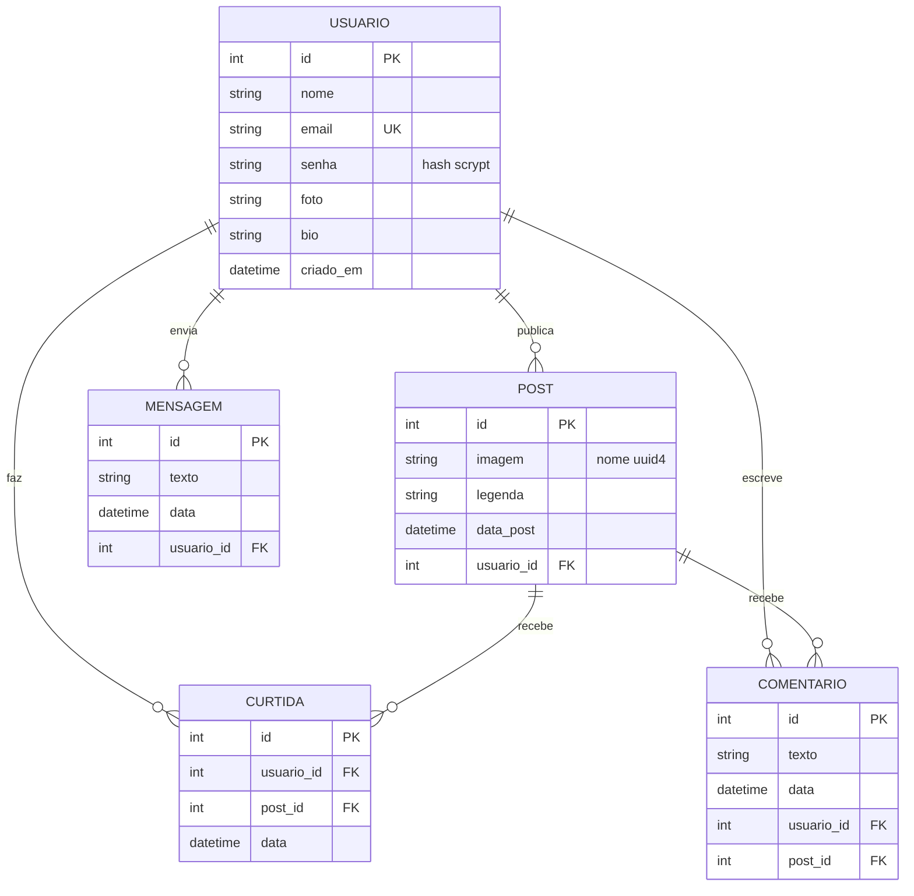

# instantâneo — Mini Rede Social com Flask

Atividade prática da disciplina **Programação Web 3**: uma mini rede social com feed de fotos, curtidas, comentários e **chat em tempo real** com Socket.IO.

Cada publicação aparece como uma foto instantânea (estilo Polaroid), com a legenda escrita à mão na faixa de baixo.


---

## Como rodar

```bash
pip install -r requirements.txt
python app.py
```

Acesse **http://localhost:5000**.

Na primeira execução, o banco `models/rede_social.sqlite3` é criado e o site já é preenchido com **dados de exemplo**: 6 pessoas, 12 fotos, curtidas, comentários e mensagens no chat.

| Conta de exemplo | Senha |
|---|---|
| `carla@exemplo.com` | `123456` |
| `ana@exemplo.com`, `bruno@exemplo.com`, `bia@exemplo.com`, `lucas@exemplo.com`, `joao@exemplo.com` | `123456` |

Para testar o chat, entre com uma conta numa aba normal e com outra numa aba anônima.

Para começar sem os exemplos, troque `CARREGAR_EXEMPLOS = True` para `False` no `app.py`.

---

## Requisitos da atividade

### 1. Autenticação de usuários

- **Cadastro** (`/cadastro`): nome/apelido, e-mail e senha. A senha é gravada com `generate_password_hash(senha, method='scrypt')`, e e-mails duplicados são recusados.
- **Login** (`/login`): confere o e-mail e o hash com `check_password_hash`, salva `user_id`, `usuario_nome` e `usuario_email` na `session` e avisa o resultado com `flash()`.
- **Logout** (`/logout`): `session.clear()` e volta para o login.
- **Controle de acesso**: `@app.before_request` manda para `/login` quem não está logado e tenta abrir `/feed`, `/upload`, `/chat` (e as rotas extras).

### 2. Postagens e feed de fotos

- Modelo `Post` com `id`, `imagem`, `legenda`, `data_post` e `usuario_id` (chave estrangeira para `Usuario`).
- Formulário com `enctype="multipart/form-data"`, `<input type="file" name="file" required>` e `<input type="text" name="legenda">`.
- Aceita só **png, jpg, jpeg e gif**, renomeia com **`uuid.uuid4()`** e salva em `app.config['UPLOAD_FOLDER']` (`static/uploads`).
- O feed mostra as fotos da mais nova para a mais antiga, com imagem, autor (pelo relacionamento `post.autor`), legenda e data/hora.

### 3. Chat coletivo em tempo real

- Só quem está logado abre o chat. Conexões Socket.IO sem sessão são recusadas.
- O nome exibido vem de `session['usuario_nome']`, no servidor.
- Evento `join`: avisa a todos "Fulano entrou no chat".
- Evento `msg`: o servidor retransmite com `emit("showmsg", data, broadcast=True)`.
- Envio pelo botão **Enviar** ou pela tecla **Enter**.

---

## Desafios extras

Os 4 desafios do enunciado:

- [x] **Botão de exclusão**: o autor apaga a própria foto do feed e do disco (`os.remove`).
- [x] **Foto de perfil**: aparece ao lado do nome no feed, no chat e no menu.
- [x] **Curtidas**: tabela associativa `Curtida`, sem recarregar a página. Dois cliques na foto também curtem.
- [x] **Notificação no chat**: som curto e título da aba piscando quando chega mensagem com a aba em segundo plano.

E mais:

- **Comentários** nos posts.
- **Perfil** com capa, bio, contagem de fotos e curtidas, e grade de fotos. Dá para editar nome, bio e foto.
- **Explorar**: busca de pessoas e grade com todas as fotos.
- **Stories**: quem publicou nas últimas 24 h aparece com anel colorido no topo do feed.
- **Chat**: histórico das últimas 50 mensagens, lista de quem está online, "está digitando…" e seletor de emojis.
- **Tema claro e escuro**, guardado no navegador.
- Upload **arrastando a foto**, com prévia antes de publicar.
- Layout responsivo: menu lateral no computador e barra inferior no celular.
- O banco se **atualiza sozinho**: colunas e tabelas novas são adicionadas sem apagar os dados.

---

## Estrutura de pastas (MVC)

```
PW3-atividade-rede-social/
├── app.py                  # Configurações do Flask, banco e SocketIO
├── requirements.txt
├── models/
│   ├── database.py         # SQLAlchemy: Usuario, Post, Curtida, Comentario, Mensagem
│   └── exemplos.py         # Dados de exemplo carregados na primeira execução
├── controllers/
│   ├── routes.py           # Rotas HTTP (login, cadastro, feed, upload, perfil…)
│   └── chat.py             # Eventos do SocketIO (connect, join, msg, digitando)
├── static/
│   ├── css/style.css       # Visual do site (tema claro e escuro)
│   ├── exemplos/           # Imagens ilustradas usadas pelos dados de exemplo
│   └── uploads/            # Fotos enviadas (posts e perfil/)
└── views/
    ├── base.html           # Layout com menu, avisos (flash) e tema
    ├── cadastro.html
    ├── login.html
    ├── feed.html           # Linha do tempo e formulário de postagem
    ├── chat.html           # Chat em tempo real
    ├── explorar.html
    ├── perfil.html
    ├── editar_perfil.html
    ├── 404.html
    └── _*.html             # Partes reaproveitadas (avatar, comentário…)
```

---

## Rotas

| Rota | Método | Login | O que faz |
|---|---|---|---|
| `/` | GET | — | Vai para o feed ou para o login |
| `/cadastro` | GET, POST | — | Cria conta |
| `/login` | GET, POST | — | Entra na conta |
| `/logout` | GET | — | Sai da conta |
| `/feed` | GET | ✔ | Linha do tempo |
| `/upload` | POST | ✔ | Publica uma foto |
| `/curtir/<id>` | POST | ✔ | Curte ou descurte (responde JSON) |
| `/comentar/<id>` | POST | ✔ | Comenta num post |
| `/excluir/<id>` | POST | ✔ | Apaga o próprio post |
| `/explorar` | GET | ✔ | Todas as fotos e pessoas |
| `/perfil/<id>` | GET | ✔ | Perfil de alguém |
| `/perfil/editar` | GET, POST | ✔ | Edita nome, bio e foto |
| `/chat` | GET | ✔ | Chat da turma |

## Eventos Socket.IO

| Evento | Direção | Dados |
|---|---|---|
| `join` | navegador → servidor | — |
| `status` | servidor → todos | `{msg}`: "Fulano entrou no chat" |
| `online` | servidor → todos | lista de quem está com o chat aberto |
| `msg` | navegador → servidor | `{msg}` |
| `showmsg` | servidor → todos (`broadcast=True`) | `{usuario, autor, msg, hora}` |
| `digitando` | navegador → servidor → outros | `{nome}` |

## Banco de dados



---

## Tecnologias

Python · Flask · Flask-SQLAlchemy (SQLite) · Flask-SocketIO · Jinja2 · HTML5 · Bootstrap 5 · Bootstrap Icons · JavaScript

## Autor

**Mateus Pena** — [@Mateusmfmd](https://github.com/Mateusmfmd)
